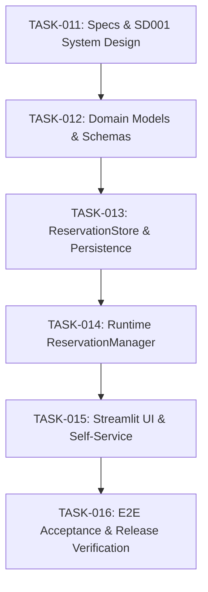

# Implementation Plan: Reservation Queue, Ownership Handoff & Status Messaging

- **Requirement**: `REQ-002: Reservation & Ownership Handoff`
- **Target Release / Milestone**: `v0.2.0-reservations`
- **Status**: Draft / Planned
- **Governance**: Follows [GEMINI.md](../../GEMINI.md) and [docs/project-overview.md](../../docs/project-overview.md)

---

## 1. Overview & Scope

This plan details the implementation of the core capabilities from [docs/project-overview.md](../../docs/project-overview.md) (excluding Teams notification integration, which is deferred to a later milestone):
1. **Reservation Queue Management** (`area:runtime`, `area:persistence`)
2. **Self-Service Reservation Management** (`area:ui`)
3. **Structured Ownership Handoff Workflow** (`area:runtime`, `area:ui`)
4. **User-to-User Status Messaging** (`area:ui`, `area:persistence`)
5. **Reservation & Handoff Audit Trail** (`area:persistence`)

---

## 2. Architecture Principles & Governance Guardrails

- **Zero External Dependencies / Offline-First**: All data is stored in local, atomic JSON files (`config.json`, `status.json`, `activity_log.json`, `reservations.json`). No external databases or cloud brokers.
- **Spec-Driven**: Every capability is defined first in `.sdlc/specs/REQ-002-reservation-and-handoff/` before code is committed.
- **Continuous Knowledge**: Architectural decisions and trade-offs are logged in `.sdlc/docs/decisions.log`.
- **Branching Workflow**: Every task is implemented on a dedicated branch `feature/task<NNN>-<description>` off `main`.
- **Conventional Commits**: Commits must follow `<type>(<scope>): <message>` with issue footers (`Ref TASK-XXX` or `Closes #XXX`).
- **Deterministic Quality Gates**: Every task branch must pass:
  ```powershell
  .venv\Scripts\ruff check .
  .venv\Scripts\ruff format --check .
  .venv\Scripts\pytest; if ($?) { .venv\Scripts\python tools\check_coverage.py coverage.json }
  ```
  Line coverage `>= 86.0%`, Branch coverage `>= 86.0%`, 0 ruff errors.

---

## 3. Work Breakdown & Task Tracking



---

### Phase 0: System Design & Specification

#### [x] `TASK-011`: System Design Document & Architecture Decision Records
- **Branch**: `feature/task011-reservation-spec`
- **Labels**: `type:spec`, `area:architecture`
- **Objectives**:
  - Author `.sdlc/specs/REQ-002-reservation-and-handoff/SD001_System_Design_v0.1.md`:
    - Entity models: `Reservation`, `QueueState`, `HandoffSession`, `StatusNote`.
    - Pure state transitions:
      - Queue: `QUEUED` &rarr; `READY` &rarr; `ACTIVE` &rarr; `COMPLETED` / `CANCELLED` / `EXPIRED`.
      - Handoff: `IDLE` &rarr; `OFFERED` &rarr; `CLAIMED` / `TIMED_OUT`.
    - Concurrency model: Multi-threaded Streamlit UI interactions alongside the background poller thread.
    - File format specification for `reservations.json` (schemaVersion 1).
    - Event schemas for `activity_log.json` audit trail (`reservation_queued`, `reservation_cancelled`, `handoff_initiated`, `handoff_claimed`, `reservation_expired`, `status_note_posted`).
    - Startup recovery and reconciliation rules when PC restarts mid-queue.
  - Record architectural decisions in `.sdlc/docs/decisions.log` (`DEC-010`).
  - Update [docs/data-files.md](../../docs/data-files.md) and [docs/operations.md](../../docs/operations.md).
- **Commit Pattern**: `docs(specs): author SD001 system design for reservation and handoff Ref TASK-011`

---

### Phase 1: Domain Models, State Machines & Validation Schemas

#### [x] `TASK-012`: Reservation Domain Models, State Machine & Validation Schemas
- **Branch**: `feature/task012-reservation-domain-models`
- **Labels**: `type:feature`, `area:runtime`, `area:persistence`
- **Files**:
  - `src/pc_handoff/domain/reservations.py`
  - `src/pc_handoff/domain/models.py`
  - `src/pc_handoff/persistence/schemas.py`
  - `tests/unit/test_reservation_models.py`
  - `tests/unit/test_reservation_state_machine.py`
  - `tests/unit/test_schemas_reservations.py`
- **Objectives**:
  - Implement immutable dataclasses:
    - `Reservation`: `reservationId` (UUID), `userName`, `requestedDurationMinutes`, `queuedAt`, `status`, `notes`.
    - `HandoffState`: `offeredByUserName`, `targetUserName`, `offeredAt`, `expiresAt`.
    - `StatusNote`: `noteId`, `userName`, `message`, `postedAt`, `expiresAt`.
  - Implement pure state transitions: queue advance, RDP session correlation, and grace-period timeouts.
  - Implement strict schema validation for `reservations.json` and new activity event types.
- **Commit Pattern**: `feat(domain): add reservation models state machine and schemas Ref TASK-012`

---

### Phase 2: Persistence & Atomic Storage Layer

#### [x] `TASK-013`: ReservationStore, ActivityLog Integration & Startup Loader
- **Branch**: `feature/task013-reservation-persistence`
- **Labels**: `type:feature`, `area:persistence`
- **Files**:
  - `src/pc_handoff/persistence/reservation_store.py`
  - `src/pc_handoff/persistence/activity_log_store.py`
  - `src/pc_handoff/persistence/startup_loader.py`
  - `src/pc_handoff/persistence/paths.py`
  - `tests/integration/test_reservation_store.py`
  - `tests/integration/test_reservation_startup_loader.py`
- **Objectives**:
  - Implement `ReservationStore` with atomic file writes (`.tmp` + atomic rename) and corrupt backup handling (`reservations.json.corrupt-...`).
  - Extend `ActivityLogStore` to append and pair reservation lifecycle events.
  - Implement startup loading and reconciliation with active sessions in `startup_loader.py`.
- **Commit Pattern**: `feat(persistence): add atomic reservation store and activity log events Ref TASK-013`

---

### Phase 3: Runtime Service, Concurrency & Poller Integration

#### [x] `TASK-014`: Thread-Safe ReservationManager & Poller Evaluation
- **Branch**: `feature/task014-reservation-runtime`
- **Labels**: `type:feature`, `area:runtime`
- **Files**:
  - `src/pc_handoff/runtime/reservation_manager.py`
  - `src/pc_handoff/runtime/poller.py`
  - `src/pc_handoff/runtime/app_runtime.py`
  - `src/pc_handoff/runtime/state_store.py`
  - `tests/unit/test_reservation_manager.py`
  - `tests/integration/test_reservation_runtime.py`
- **Objectives**:
  - Implement `ReservationManager` providing thread-safe mutation commands (`enqueueReservation`, `cancelReservation`, `initiateHandoff`, `postStatusNote`).
  - Integrate periodic evaluation in `Poller` tick: evaluate handoff claim timeouts, detect session status shifts, and correlate RDP logins with reservations.
  - Update `DashboardSnapshot` to include immutable queue and message state for UI consumers.
- **Commit Pattern**: `feat(runtime): add thread-safe reservation manager and poller timeout checks Ref TASK-014`

---

### Phase 4: Streamlit UI & Self-Service Interaction

#### [ ] `TASK-015`: Self-Service Reservation Dashboard & Messaging UI
- **Branch**: `feature/task015-streamlit-reservation-ui`
- **Labels**: `type:feature`, `area:ui`
- **Files**:
  - `src/pc_handoff/ui/dashboard.py`
  - `src/pc_handoff/ui/view_model.py`
  - `tests/unit/test_reservation_view_model.py`
  - `tests/ui/test_dashboard_reservation_apptest.py`
- **Objectives**:
  - Extend `DashboardViewModel` with queue tables, claim countdowns, and broadcast notes.
  - Add self-service UI controls in `dashboard.py`:
    - "Join Queue" form (User Name, Estimated Duration, Notes).
    - "My Queue Slot" / Cancel action.
    - "Ready to Handoff" trigger for current active user.
    - Prominent countdown notice for next user in line.
    - Status note announcement banner and note submission form.
  - Enforce markdown escaping (`escapeMarkdown`) and length constraints on all user inputs.
- **Commit Pattern**: `feat(ui): implement reservation queue and handoff controls in dashboard Ref TASK-015`

---

### Phase 5: End-to-End Acceptance, Quality & Milestone Release

#### [ ] `TASK-016`: Acceptance Test Suite, Documentation Freeze & Release Verification
- **Branch**: `feature/task016-reservation-acceptance`
- **Labels**: `type:test`, `area:acceptance`
- **Files**:
  - `tests/acceptance/test_reservation_acceptance.py`
  - `tests/acceptance/test_handoff_acceptance.py`
  - `docs/manual-acceptance.md`
- **Objectives**:
  - Implement automated end-to-end acceptance scenarios:
    1. Full Queue & Handoff Lifecycle (Join &rarr; Active yields &rarr; Next claims &rarr; Session connects &rarr; Audit logged).
    2. Handoff Claim Timeout & Auto-Advance to next queued user.
    3. Crash & Restart mid-queue with faithful state restoration.
  - Document manual acceptance procedures in `docs/manual-acceptance.md`.
  - Validate all quality gates:
    - 0 ruff errors/warnings.
    - Line coverage `>= 86.0%`, Branch coverage `>= 86.0%`.
  - Prepare release branch `release/v0.2.0`.
- **Commit Pattern**: `test(acceptance): add end-to-end reservation and handoff test suite Ref TASK-016`

---

## 4. Milestone Schedule & Gates

| Task | Title | Target Artifacts | Validation Gate |
| :--- | :--- | :--- | :--- |
| **`TASK-011`** | Specs & System Design | `SD001_System_Design_v0.1.md`, `decisions.log` | Spec review & doc lint |
| **`TASK-012`** | Domain Models & Schemas | `domain/reservations.py`, `schemas.py` | Unit tests (`>= 86%` cov) |
| **`TASK-013`** | Storage & Persistence | `reservation_store.py`, `activity_log_store.py` | Fault & atomic store tests |
| **`TASK-014`** | Runtime & Poller | `reservation_manager.py`, `poller.py` | Concurrency & tick tests |
| **`TASK-015`** | Streamlit UI Controls | `dashboard.py`, `view_model.py` | Streamlit `AppTest` suite |
| **`TASK-016`** | Acceptance & Release | Acceptance tests, `manual-acceptance.md` | Full gated suite + ruff |
