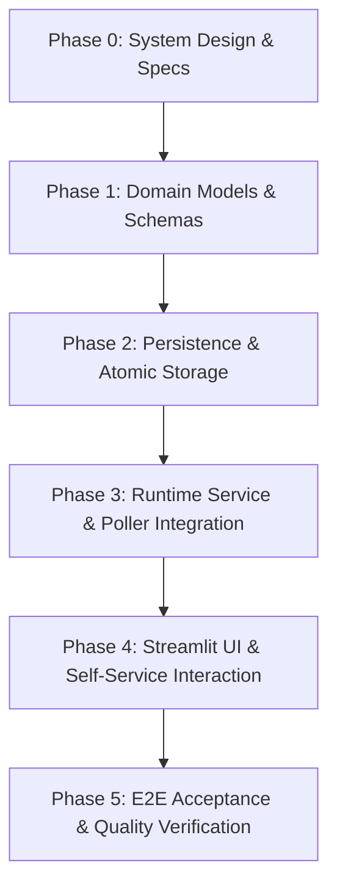

# Implementation Plan: Reservation Queue, Ownership Handoff & Status Messaging

This plan details the phased implementation of the remaining core capabilities specified in [docs/project-overview.md](docs/project-overview.md) (excluding Teams notification integration, which is deferred):
1. **Reservation Queue Management**
2. **Self-Service Reservation Management (UI)**
3. **Structured Ownership Handoff Workflow**
4. **User-to-User Status Messaging**
5. **Reservation & Handoff Audit Trail**

---

## Architecture Principles & Guardrails

- **Zero External Dependencies / Offline-First**: All data is stored in local, atomic JSON files. No cloud databases, external brokers, or auth servers.
- **Spec-Driven & Documented**: System design (`SD001_System_Design_v0.1.md`) precedes implementation, and file format specs are maintained in `docs/`.
- **Thread Safety & Non-Blocking Dashboard**: Reading the dashboard snapshot remains non-blocking via reference swap (`StateStore`). Mutations (e.g. queue join, handoff initiation) use a thread-safe runtime command interface.
- **Fault-Tolerant Persistence**: Atomic file writes (`.tmp` + rename), automatic corrupt-file backup (`.corrupt-<timestamp>`), and startup reconciliation ensure state survives crashes and reboots.
- **Test-First Quality & Coverage**: Full automated test suites (unit, integration, UI AppTest, end-to-end acceptance) strictly enforcing the >= 86% line and branch coverage gates.

---

## Phase Breakdown & Tasks



---

### Phase 0: System Design & Specification

- [ ] **Task 0.1: Author System Design Document (`docs/SD001_System_Design_v0.1.md`)**
  - **Objectives**:
    - Define domain entities: `Reservation`, `QueueState`, `HandoffSession`, `UserMessage`.
    - Define state transition machines:
      - Queue lifecycle: `QUEUED` -> `READY` -> `ACTIVE` -> `COMPLETED` / `CANCELLED` / `EXPIRED`.
      - Handoff lifecycle: `IDLE` -> `OFFERED` -> `CLAIMED` / `TIMED_OUT`.
    - Specify concurrency model: Handling Streamlit UI thread actions (button clicks, form submits) safely alongside the poller thread.
    - Specify local file format for `reservations.json` (schema version 1) and status notes.
    - Define audit event schemas for `activity_log.json`:
      - `reservation_queued`, `reservation_cancelled`, `handoff_initiated`, `handoff_claimed`, `reservation_expired`, `status_note_posted`.
    - Detail startup reconciliation rules when the PC restarts while reservations or handoffs are active.
  - **Deliverable**: [docs/SD001_System_Design_v0.1.md](docs/SD001_System_Design_v0.1.md).

- [ ] **Task 0.2: Documentation Alignment**
  - **Objectives**:
    - Update [docs/data-files.md](docs/data-files.md) with `reservations.json` schema and new activity log event types.
    - Update [docs/operations.md](docs/operations.md) with new configuration parameters:
      - `handoffClaimTimeoutSeconds` (default: 300 s / 5 min).
      - `maxQueueLength` (default: 10).
      - `maxReservationDurationMinutes` (default: 120 min).
  - **Deliverables**: Updated [docs/data-files.md](docs/data-files.md), [docs/operations.md](docs/operations.md).

---

### Phase 1: Domain Models, State Machines & Validation Schemas

- [ ] **Task 1.1: Core Domain Models & State Transitions**
  - **Files**: `src/pc_handoff/domain/reservations.py`, `src/pc_handoff/domain/models.py`.
  - **Objectives**:
    - Implement immutable dataclasses:
      - `Reservation`: `reservationId` (UUID), `userName`, `requestedDurationMinutes`, `queuedAt`, `status`, `notes`.
      - `HandoffState`: `offeredByUserName`, `targetUserName`, `offeredAt`, `expiresAt`.
      - `StatusNote`: `noteId`, `userName`, `message`, `postedAt`, `expiresAt`.
    - Implement pure state transition functions:
      - Advancing the queue when active usage ends.
      - Correlating an incoming RDP session with the `READY` reservation holder.
      - Grace-period expiry evaluations.
  - **Tests**: `tests/unit/test_reservation_models.py`, `tests/unit/test_reservation_state_machine.py`.

- [ ] **Task 1.2: Validation Schemas & Serialization**
  - **Files**: `src/pc_handoff/persistence/schemas.py`.
  - **Objectives**:
    - Strict schema validator for `reservations.json` (structure, required keys, timestamps with offset, UUID formats).
    - Validation for new activity log event types (`reservation_queued`, `handoff_initiated`, etc.).
    - Corrupt payload detection matching existing ADR-005 rules.
  - **Tests**: `tests/unit/test_schemas_reservations.py`, `tests/unit/test_schemas_activity.py`.

---

### Phase 2: Persistence & Atomic Storage Layer

- [ ] **Task 2.1: `ReservationStore` Implementation**
  - **File**: `src/pc_handoff/persistence/reservation_store.py`.
  - **Objectives**:
    - Implement `ReservationStore` backed by `reservations.json`:
      - Atomic write via `replaceFileAtomic` (`.tmp-<pid>-<hex>` -> atomic rename).
      - Corrupt-file backup naming (`reservations.json.corrupt-<timestamp>`).
      - In-memory cache with safe query snapshots.
  - **Tests**: `tests/integration/test_reservation_store.py` (atomic replacements, corrupt recovery, missing file creation).

- [ ] **Task 2.2: Activity Log Integration**
  - **Files**: `src/pc_handoff/persistence/activity_log_store.py`, `src/pc_handoff/domain/models.py`.
  - **Objectives**:
    - Extend `ActivityEvent` to capture reservation and handoff lifecycle events.
    - Ensure self-contained event fields and pairing integrity.
  - **Tests**: `tests/integration/test_activity_log_reservation_events.py`.

- [ ] **Task 2.3: Startup Loader & Reconciliation**
  - **Files**: `src/pc_handoff/persistence/startup_loader.py`.
  - **Objectives**:
    - Load `reservations.json` during launcher startup.
    - Reconcile pending reservations against active sessions detected upon startup.
  - **Tests**: `tests/integration/test_reservation_startup_loader.py`.

---

### Phase 3: Runtime Service, Concurrency & Poller Integration

- [ ] **Task 3.1: Thread-Safe `ReservationManager` Service**
  - **File**: `src/pc_handoff/runtime/reservation_manager.py`.
  - **Objectives**:
    - Provide a thread-safe facade for Streamlit UI actions and background poller ticks:
      - `enqueueReservation(userName, durationMinutes, notes)`
      - `cancelReservation(reservationId, userName)`
      - `initiateHandoff(fromUser, targetReservationId)`
      - `claimHandoff(reservationId, sessionInfo)`
      - `postStatusNote(userName, message)`
      - `clearStatusNote(noteId)`
    - Mutex-locked operations ensuring consistency between in-memory state, disk stores, and audit events.
  - **Tests**: `tests/unit/test_reservation_manager.py`.

- [ ] **Task 3.2: Poller Background Checks & Session Correlation**
  - **Files**: `src/pc_handoff/runtime/poller.py`, `src/pc_handoff/runtime/app_runtime.py`.
  - **Objectives**:
    - In each poll cycle:
      - Detect session status transitions (`In Use` -> `Available`).
      - Evaluate handoff timeouts (e.g. if the next user has not connected via RDP within 5 minutes, forfeit slot and advance queue).
      - Automatically match newly connected RDP username with the `READY` reservation to mark as `ACTIVE`.
    - Publish updated `DashboardSnapshot` including queue state and status notes.
  - **Tests**: `tests/integration/test_runtime_reservation_poll.py`.

---

### Phase 4: Streamlit UI & Self-Service Interaction

- [ ] **Task 4.1: View Model Extensions**
  - **File**: `src/pc_handoff/ui/view_model.py`.
  - **Objectives**:
    - Extend `DashboardSnapshot` and `DashboardViewModel`:
      - Queue table rows: Position, User, Estimated Start, Duration, Status.
      - Handoff status banner: "PC ready for [User] (claim within MM:SS)".
      - Status notes area.
    - Sanitization: All user-submitted text escaped via `escapeMarkdown` and bounded in length.
  - **Tests**: `tests/unit/test_reservation_view_model.py`.

- [ ] **Task 4.2: Self-Service UI Controls**
  - **File**: `src/pc_handoff/ui/dashboard.py`.
  - **Objectives**:
    - Section: **Active Status Note** (broadcast message and "Leave a note" form).
    - Section: **Reservation Queue**:
      - Table showing current queue and positions.
      - "Join Queue" form (Name, Duration, Notes).
      - "Leave Queue / Cancel My Reservation" action.
    - Section: **Ownership Handoff**:
      - For current user: "Ready to Handoff" button.
      - For next user: Notice alerting that the PC is reserved for them with claim countdown.
  - **Tests**: `tests/ui/test_dashboard_reservation_apptest.py` (Streamlit `AppTest` simulating form submissions and button clicks).

---

### Phase 5: End-to-End Acceptance, Audit & Performance Verification

- [ ] **Task 5.1: End-to-End Acceptance Tests**
  - **Files**: `tests/acceptance/test_reservation_acceptance.py`, `tests/acceptance/test_handoff_acceptance.py`.
  - **Test Scenarios**:
    1. **Complete Queue & Handoff Lifecycle**:
       - PC is `In Use` by User A.
       - User B joins queue.
       - User A clicks "Ready to Handoff".
       - User B is notified PC is ready for them.
       - User B connects via RDP.
       - System detects User B active; reservation transitions to `ACTIVE`.
       - All events recorded in `activity_log.json`.
    2. **Handoff Timeout & Auto-Advance**:
       - User B is next in line; claim timer expires without RDP connection.
       - User B slot marked `EXPIRED`; User C advances to `READY`.
    3. **Crash & Restart Recovery**:
       - Server killed mid-queue; restarted.
       - Queue order and reservations faithfully restored from `reservations.json`.

- [ ] **Task 5.2: Code Quality, Style & Coverage Gates**
  - **Commands**:
    ```powershell
    .venv\Scripts\ruff check .
    .venv\Scripts\ruff format --check .
    .venv\Scripts\pytest; if ($?) { .venv\Scripts\python tools\check_coverage.py coverage.json }
    ```
  - **Gate Requirements**:
    - 0 lint errors, 0 format warnings.
    - Total test suite passing.
    - Line coverage >= 86%, Branch coverage >= 86%.

---

## Suggested Milestone Timeline

| Milestone | Deliverables | Key Validation |
| :--- | :--- | :--- |
| **M1: Design & Models** | `docs/SD001_System_Design_v0.1.md`, updated `data-files.md`, domain models & schemas | Unit tests for state machine & schemas |
| **M2: Storage & Audit** | `ReservationStore`, atomic writes, corruption recovery, audit event logging | Integration tests with simulated disk faults |
| **M3: Runtime & Poller** | `ReservationManager`, background timeout checks, session-matching | Concurrency and poller integration tests |
| **M4: Dashboard UI** | Streamlit forms, queue display, handoff prompts, note posting | Streamlit `AppTest` interactive UI tests |
| **M5: Acceptance & Release**| Acceptance suite, documentation updates, full coverage verification | Coverage gate (>86%) and manual acceptance |
