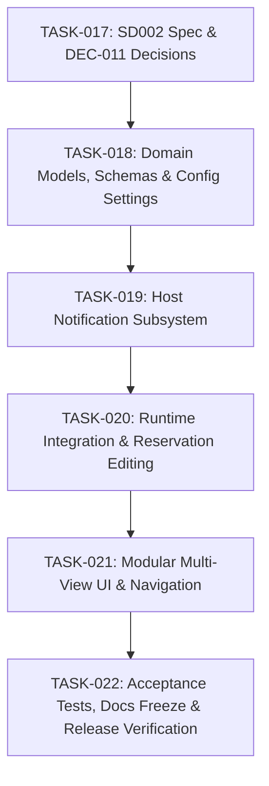

# Implementation Plan: Dedicated Management UI, Host Notifications & Self-Service Enhancements

- **Requirement**: `REQ-003: Dedicated Management UI, Host Notifications & Advanced Self-Service`
- **Target Release / Milestone**: `v0.3.0-manage-and-notify`
- **Status**: In Progress / Planned
- **Governance**: Follows [GEMINI.md](../../GEMINI.md) and [docs/project-overview.md](../../docs/project-overview.md)
- **Supercedes / Extends**: [PLAN-001-reservation-and-handoff.md](PLAN-001-reservation-and-handoff.md)

---

## 1. Overview & Scope

This plan details the implementation of `REQ-003` capabilities specified in [.sdlc/specs/REQ-003-manage-and-notify/SD002_System_Design_v0.2.md](../specs/REQ-003-manage-and-notify/SD002_System_Design_v0.2.md):
1. **Dedicated Management View & Header Navigation**: Two-view router connecting Status and Manage views with clear header action buttons.
2. **Tabbed Self-Service Experience**: Semantic tabs for "Join Queue" (with wait estimation), "Ready to Handoff" (with `.rdp` download), and "Post Status Note" (with category tags).
3. **Queue Slot Modification**: Updating duration and notes on queued reservations without forfeiting queue priority.
4. **Host PC Notifications**: Zero-dependency Windows desktop toasts and terminal broadcast messages triggered on queue join and handoff events.
5. **Architectural Refactoring**: Modular view separation in `src/pc_handoff/ui/views/` and notification subsystem in `src/pc_handoff/notifications/`.

---

## 2. Architecture Principles & Governance Guardrails

- **Zero External Dependencies / Offline-First**: Notifications use built-in Windows facilities (PowerShell WinRT / `msg.exe`). No third-party notification packages or cloud services.
- **Spec-Driven**: Architectural specifications in `SD002_System_Design_v0.2.md`.
- **Continuous Knowledge**: Architectural decisions logged in `.sdlc/docs/decisions.log` (`DEC-011`).
- **Branching Workflow**: Tasks follow `feature/task<NNN>-<description>` off `main`.
- **Deterministic Quality Gates**: Every task branch must pass:
  ```powershell
  .venv\Scripts\ruff check .
  .venv\Scripts\ruff format --check .
  .venv\Scripts\pytest; if ($?) { .venv\Scripts\python tools\check_coverage.py coverage.json }
  ```
  Line coverage `>= 86.0%` (target `100.0%`), Branch coverage `>= 86.0%` (target `100.0%`), 0 ruff errors.

---

## 3. Work Breakdown & Task Tracking



---

### Phase 0: System Design & Specification

#### [x] `TASK-017`: System Design Document & Architecture Decision Records
- **Branch**: `feature/task017-v030-spec-and-plan`
- **Labels**: `type:spec`, `area:architecture`
- **Objectives**:
  - Author `.sdlc/specs/REQ-003-manage-and-notify/SD002_System_Design_v0.2.md`.
  - Author `.sdlc/plans/PLAN-002-manage-and-notify.md`.
  - Record architectural decisions in `.sdlc/docs/decisions.log` (`DEC-011`).
- **Commit Pattern**: `docs(specs): author SD002 system design and PLAN-002 roadmap Ref TASK-017`

---

### Phase 1: Domain Models, Schemas & Config Settings

#### [x] `TASK-018`: Domain Models, Schemas & Notification Config Settings
- **Branch**: `feature/task018-models-schemas-config`
- **Labels**: `type:feature`, `area:runtime`, `area:persistence`
- **Files**:
  - `src/pc_handoff/domain/reservations.py`
  - `src/pc_handoff/persistence/schemas.py`
  - `src/pc_handoff/persistence/config_store.py`
  - `tests/unit/test_reservation_models.py`
  - `tests/unit/test_schemas_reservations.py`
  - `tests/unit/test_config_store.py`
- **Objectives**:
  - Add `NoteCategory` (`general`, `urgent`, `maintenance`, `long_running`) to `StatusNote` and schemas.
  - Implement pure transition `updateReservation` and `reservation_updated` audit event.
  - Implement queue wait-time estimation calculation helper.
  - Extend `Config` with `enableHostNotifications`, `hostNotificationMethod`, and `hostNotificationTimeoutSeconds`.
- **Commit Pattern**: `feat(domain): add note categories reservation editing and notification config Ref TASK-018`

---

### Phase 2: Host Notification Subsystem

#### [ ] `TASK-019`: Host Notification Subsystem (Windows Toast & Broadcast)
- **Branch**: `feature/task019-host-notifications`
- **Labels**: `type:feature`, `area:runtime`
- **Files**:
  - `src/pc_handoff/notifications/notifier.py`
  - `src/pc_handoff/notifications/windows_notifier.py`
  - `tests/unit/test_notifications.py`
- **Objectives**:
  - Implement abstract `Notifier` protocol.
  - Implement `WindowsNotifier` supporting native PowerShell WinRT toasts and `msg.exe` broadcast.
  - Implement asynchronous background thread worker to prevent blocking execution.
  - Implement failure containment catching all subprocess timeouts and OS errors.
- **Commit Pattern**: `feat(notifications): add zero-dependency windows host notifier Ref TASK-019`

---

### Phase 3: Runtime Integration & Editing Service

#### [ ] `TASK-020`: Runtime Integration, Reservation Editing & Notification Hooks
- **Branch**: `feature/task020-runtime-integration`
- **Labels**: `type:feature`, `area:runtime`
- **Files**:
  - `src/pc_handoff/runtime/reservation_manager.py`
  - `src/pc_handoff/runtime/app_runtime.py`
  - `src/pc_handoff/launcher.py`
  - `tests/unit/test_reservation_manager.py`
  - `tests/integration/test_reservation_runtime.py`
- **Objectives**:
  - Add `updateReservation` method to `ReservationManager`.
  - Wire `Notifier` into `ReservationManager` for queue join, handoff offer, and claim expiration events.
  - Update `launcher.py` `buildRuntime` to assemble the notifier from config.
- **Commit Pattern**: `feat(runtime): wire host notifications and reservation update in runtime Ref TASK-020`

---

### Phase 4: Modular Multi-View UI & Navigation

#### [ ] `TASK-021`: Modular Multi-View Streamlit UI & Tabbed Management Interface
- **Branch**: `feature/task021-modular-ui-tabs`
- **Labels**: `type:feature`, `area:ui`
- **Files**:
  - `src/pc_handoff/ui/navigation.py`
  - `src/pc_handoff/ui/views/status_view.py`
  - `src/pc_handoff/ui/views/manage_view.py`
  - `src/pc_handoff/ui/view_model.py`
  - `src/pc_handoff/ui/dashboard.py`
  - `tests/unit/test_view_model.py`
  - `tests/ui/test_dashboard_apptest.py`
  - `tests/ui/test_dashboard_reservation_apptest.py`
- **Objectives**:
  - Implement `NavigationController` managing transitions between Status and Manage views.
  - Implement `status_view.py` with top-right "⚙️ Manage Queue & Notes" button.
  - Implement `manage_view.py` with top-left "← Back to PC Status" button and 3 semantic tabs ("Join Queue" with wait estimates, "Ready to Handoff" with `.rdp` download, "Post Status Note" with category tags).
  - Add in-memory `.rdp` connection file generator.
- **Commit Pattern**: `feat(ui): implement modular two-view navigation and tabbed management interface Ref TASK-021`

---

### Phase 5: Acceptance Verification, Documentation Freeze & Release

#### [ ] `TASK-022`: Acceptance Test Suite, Documentation Freeze & Milestone Release
- **Branch**: `feature/task022-release-v030`
- **Labels**: `type:test`, `area:acceptance`
- **Files**:
  - `tests/acceptance/test_manage_view_acceptance.py`
  - `tests/acceptance/test_notification_acceptance.py`
  - `docs/operations.md`
  - `docs/data-files.md`
  - `docs/manual-acceptance.md`
- **Objectives**:
  - Implement automated end-to-end acceptance tests for multi-view navigation, `.rdp` download, reservation editing, and notification dispatch.
  - Update operator documentation and manual checklist.
  - Validate all quality gates:
    - 0 ruff errors/warnings.
    - Line coverage `>= 86.0%` (target `100.0%`), Branch coverage `>= 86.0%` (target `100.0%`).
  - Merge into `main` and prepare release branch `release/v0.3.0`.
- **Commit Pattern**: `test(acceptance): add e2e tests for manage view and host notifications Ref TASK-022`

---

## 4. Milestone Schedule & Gates

| Task | Title | Target Artifacts | Validation Gate |
| :--- | :--- | :--- | :--- |
| **`TASK-017`** | Specs & System Design | `SD002_System_Design_v0.2.md`, `decisions.log` | Spec review & doc lint |
| **`TASK-018`** | Domain Models & Schemas | `reservations.py`, `schemas.py`, `config_store.py` | Unit tests (`>= 86%` cov) |
| **`TASK-019`** | Host Notifications | `notifier.py`, `windows_notifier.py` | Mock subprocess unit tests |
| **`TASK-020`** | Runtime & Updating | `reservation_manager.py`, `app_runtime.py` | Thread-safe mutation tests |
| **`TASK-021`** | Modular UI & Tabs | `navigation.py`, `status_view.py`, `manage_view.py` | Streamlit AppTest suite |
| **`TASK-022`** | Acceptance & Release | Acceptance tests, doc freeze, `release/v0.3.0` | Full gated suite + ruff |
