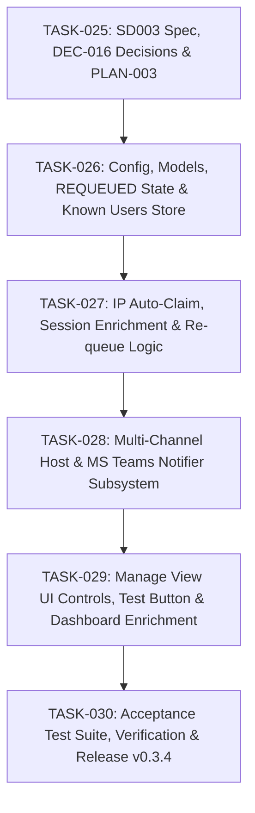

# Implementation Plan: Extended Queue Life, Smart Handoff Correlation & Multi-Channel Notifications

- **Requirement**: `REQ-004: Extended Queue Life, Smart Handoff Correlation & Multi-Channel Notifications`
- **Target Release / Milestone**: `v0.3.4`
- **Status**: Ready for Review / Implementation
- **Governance**: Follows [GEMINI.md](../../GEMINI.md) and [docs/project-overview.md](../../docs/project-overview.md)
- **Supercedes / Extends**: [PLAN-002-manage-and-notify.md](PLAN-002-manage-and-notify.md)

---

## 1. Overview & Scope

This plan details the implementation of `REQ-004` capabilities specified in [.sdlc/specs/REQ-004-queue-requeue-correlation-and-teams/SD003_System_Design_v0.3.md](../specs/REQ-004-queue-requeue-correlation-and-teams/SD003_System_Design_v0.3.md):
1. **Configurable Grace Period & Re-queueing**: Support `claimGraceMinutes` (1–1440 min) and transition expired `READY` reservations to `REQUEUED` at the end of the queue.
2. **Client IP Registration & Silent Handoff Auto-Claim**: Optional IP in queue form, local `known_users.json` directory, auto-claim on matching RDP connection, and enriched status labels.
3. **Reliable Host Notifications**: Support `"both"` (default) / `"msg"` / `"toast"`, Terminal Services session broadcast, and a "Test Notification" button in Manage View.
4. **Microsoft Teams Webhook Integration**: Asynchronous Adaptive Card notifications via Power Automate webhooks with zero new external dependencies.

---

## 2. Architecture Principles & Governance Guardrails

- **Zero New Dependencies / 100% Offline-First**: Built with Python standard library (`urllib.request`). If offline, webhooks fail gracefully with log containment.
- **Spec-Driven**: Architectural specification in `SD003_System_Design_v0.3.md`.
- **Continuous Knowledge**: Architectural decisions logged in `.sdlc/docs/decisions.log` (`DEC-016`).
- **Branching Workflow**: Tasks follow `feature/task<NNN>-<description>` off `main`.
- **Deterministic Quality Gates**: Every task branch must pass:
  ```powershell
  .venv\Scripts\ruff check .
  .venv\Scripts\ruff format --check .
  .venv\Scripts\pytest; if ($?) { .venv\Scripts\python tools\check_coverage.py coverage.json }
  ```
  Line coverage `>= 86.0%` (target `100.0%`), Branch coverage `>= 86.0%` (target `100.0%`), 0 ruff errors.

---

## 3. Work Breakdown & Task Tracking



---

### Task List

- [x] **`TASK-025`**: System Design Document, Architecture Decisions & Implementation Plan
  - Branch: `feature/task025-v034-spec-and-plan`
  - Deliverables: `SD003_System_Design_v0.3.md`, `PLAN-003-queue-requeue-correlation-and-teams.md`, `DEC-016` in `decisions.log`.

- [ ] **`TASK-026`**: Configurable Grace Period, REQUEUED State & Known Users Directory
  - Branch: `feature/task026-config-requeue-and-known-users`
  - Deliverables:
    - Add `claimGraceMinutes` (1–1440 min, default 60), `enableTeamsNotifications`, and `teamsWebhookUrl` to `config_store.py`.
    - Add `REQUEUED` to `ReservationStatus` and `RESERVATION_REQUEUED` to `ReservationEventType`.
    - Implement `KnownUsersStore` with atomic persistence to `data/known_users.json`.

- [ ] **`TASK-027`**: Re-queue State Machine & Silent Handoff IP Auto-Claim
  - Branch: `feature/task027-requeue-and-ip-autoclaim`
  - Deliverables:
    - Pure transition functions in `reservations.py` for re-queueing to tail of queue.
    - Poller correlation in `reservation_manager.py`: auto-claim when an active session IP matches the `READY` reservation's client address.

- [ ] **`TASK-028`**: Multi-Channel Host Broadcast & MS Teams Webhook Notifier
  - Branch: `feature/task028-host-broadcast-and-teams-webhook`
  - Deliverables:
    - Enhance `WindowsNotifier` with `"both"` method using `msg.exe *` for all active sessions.
    - Implement `TeamsNotifier` using `urllib.request` dispatching Adaptive Cards asynchronously with full failure containment.
    - Wire composite notifier in `launcher.py` and `app_runtime.py`.

- [ ] **`TASK-029`**: UI Enhancements: IP Input, Re-queued Badges, Test Notification Button
  - Branch: `feature/task029-ui-ip-input-and-test-button`
  - Deliverables:
    - Manage View: add optional Client IP field to Join Queue form with auto-detection/pre-fill.
    - Manage View: add "🔔 Test Notification" button.
    - Status View: enrich status badge with Real Name: `🔴 In Use — Real Name (IP)`.
    - Display `🔄 Re-queued` badge in reservation queue table.

- [ ] **`TASK-030`**: Acceptance Tests, End-to-End Verification & Release v0.3.4
  - Branch: `feature/task030-v034-acceptance-and-release`
  - Deliverables:
    - Acceptance tests for re-queueing, IP auto-claim, Teams webhook payload, and host notification.
    - Full quality gate verification (`100%` pass, coverage gate `>= 86.0%`).
    - Release documentation and tag `v0.3.4`.
