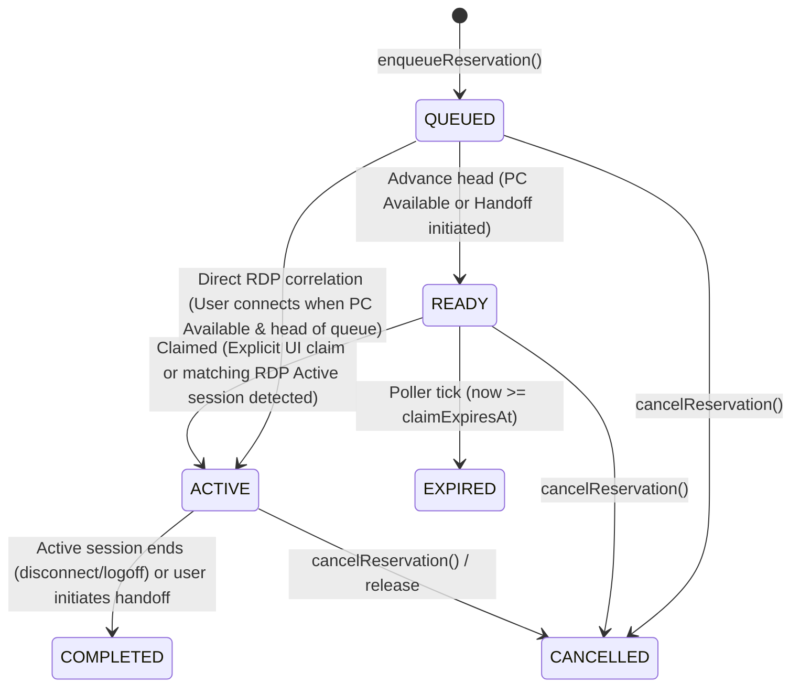
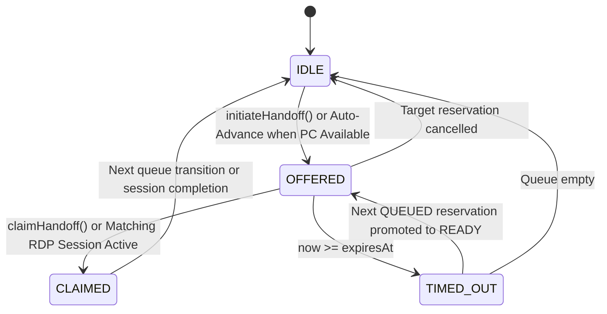
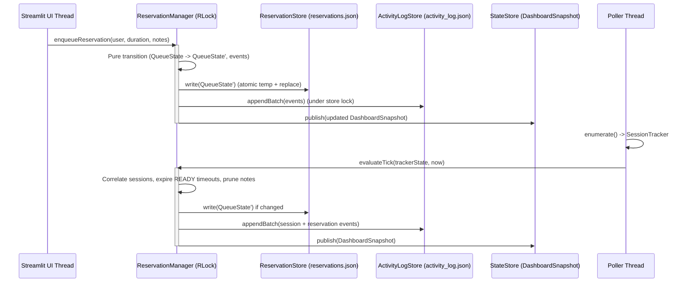

# SD001: System Design — Reservation Queue, Ownership Handoff & Status Messaging (v0.1)

- **Document ID**: `SD001`
- **Version**: `0.1`
- **Requirement**: `REQ-002: Reservation & Ownership Handoff`
- **Milestone**: `v0.2.0-reservations`
- **Status**: Approved for Implementation
- **Related Decisions**: `DEC-010` (`.sdlc/docs/decisions.log`), `ADR-002`, `ADR-003`, `ADR-005`, `ADR-008`

---

## 1. Purpose & Scope

This specification defines the system architecture, domain models, state machines, concurrency guarantees, persistence schemas, and startup reconciliation rules for **REQ-002: Reservation & Ownership Handoff** in **PC Handoff**.

### In Scope
1. **Reservation Queue Management**: FIFO queue of users waiting to use the shared PC, including position tracking, automatic advancement, claim grace-period expiration, and RDP session correlation.
2. **Self-Service Reservation Management**: LAN dashboard controls allowing users to join the queue, specify estimated duration and notes, and cancel or release their reservation.
3. **Structured Ownership Handoff Workflow**: Explicit handoff initiation by the current active user (`OFFERED`), grace-period claim window for the next user in line (`READY`), and claim resolution (`CLAIMED` or `TIMED_OUT`).
4. **User-to-User Status Messaging**: Broadcast status notes with automatic time-to-live (`expiresAt`) displayed prominently on the dashboard.
5. **Reservation & Handoff Audit Trail**: Persistent logging of reservation, handoff, and status note events in `activity_log.json`.

### Out of Scope
- Microsoft Teams webhook notifications (deferred to a subsequent milestone).
- User authentication or role-based access control (all LAN interactions are self-service by declared `userName`).

---

## 2. Domain Entity Models

All domain entities in `src/pc_handoff/domain/reservations.py` are immutable (`@dataclass(frozen=True)`), pure data structures with no I/O dependencies.

### 2.1 Enumerations

```python
class ReservationStatus(StrEnum):
    QUEUED = "QUEUED"
    READY = "READY"
    ACTIVE = "ACTIVE"
    COMPLETED = "COMPLETED"
    CANCELLED = "CANCELLED"
    EXPIRED = "EXPIRED"


class HandoffStatus(StrEnum):
    IDLE = "IDLE"
    OFFERED = "OFFERED"
    CLAIMED = "CLAIMED"
    TIMED_OUT = "TIMED_OUT"
```

### 2.2 `Reservation`
Represents a single user's reservation request in the queue or active ownership slot.

| Field | Type | Nullable | Constraints & Meaning |
| :--- | :--- | :---: | :--- |
| `reservationId` | `str` (UUID) | No | Lowercase `8-4-4-4-12` hex UUID (`uuid.uuid4()`). |
| `userName` | `str` | No | Non-empty trimmed string (`1..64` chars), case-insensitively matched against Windows session `userName`. |
| `requestedDurationMinutes` | `int` | No | Strict integer in range `5..480` (5 minutes to 8 hours). |
| `queuedAt` | `datetime` | No | Offset-aware timestamp when the reservation was created. |
| `status` | `ReservationStatus` | No | Current lifecycle state (`QUEUED`, `READY`, `ACTIVE`, `COMPLETED`, `CANCELLED`, `EXPIRED`). |
| `notes` | `str \| None` | Yes | Optional user context note (`<= 280` chars; `None` when omitted or blank). |
| `readyAt` | `datetime \| None` | Yes | Set when status transitions to `READY`; `None` when `QUEUED`. |
| `claimExpiresAt` | `datetime \| None` | Yes | Set when status is `READY` (`readyAt + claimGraceSeconds`); `None` otherwise. |
| `activatedAt` | `datetime \| None` | Yes | Set when status transitions to `ACTIVE`. |
| `endedAt` | `datetime \| None` | Yes | Set when status reaches a terminal state (`COMPLETED`, `CANCELLED`, `EXPIRED`). |

### 2.3 `HandoffSession` (`HandoffState`)
Represents an active or recently resolved ownership handoff offer between the current user and the next queued user.

| Field | Type | Nullable | Constraints & Meaning |
| :--- | :--- | :---: | :--- |
| `status` | `HandoffStatus` | No | `IDLE`, `OFFERED`, `CLAIMED`, or `TIMED_OUT`. |
| `reservationId` | `str \| None` | Yes | Target `Reservation.reservationId` when `status != IDLE`; `None` when `IDLE`. |
| `offeredByUserName` | `str \| None` | Yes | User who initiated the handoff (`None` if auto-offered when PC became `Available` or when `IDLE`). |
| `targetUserName` | `str \| None` | Yes | User in the `READY` reservation slot (`None` when `IDLE`). |
| `offeredAt` | `datetime \| None` | Yes | Timestamp when the handoff offer started (`None` when `IDLE`). |
| `expiresAt` | `datetime \| None` | Yes | Timestamp when the claim window expires (`None` when `IDLE`). |

> [!NOTE]
> `HandoffState` is aliased to `HandoffSession` in `src/pc_handoff/domain/reservations.py` so both domain and runtime modules can reference either name interchangeably.

### 2.4 `StatusNote`
Represents a lightweight user-to-user broadcast status message posted on the dashboard.

| Field | Type | Nullable | Constraints & Meaning |
| :--- | :--- | :---: | :--- |
| `noteId` | `str` (UUID) | No | Lowercase `8-4-4-4-12` hex UUID. |
| `userName` | `str` | No | Non-empty trimmed author name (`1..64` chars). |
| `message` | `str` | No | Non-empty trimmed message body (`1..280` chars). |
| `postedAt` | `datetime` | No | Offset-aware timestamp when the note was posted. |
| `expiresAt` | `datetime` | No | Offset-aware expiration timestamp (`postedAt < expiresAt`, default TTL 120 minutes). |

### 2.5 `QueueState`
Aggregate root holding the complete in-memory and persisted state of reservations, handoff, and status notes.

| Field | Type | Nullable | Constraints & Meaning |
| :--- | :--- | :---: | :--- |
| `reservations` | `tuple[Reservation, ...]` | No | Ordered tuple of reservations. Active/non-terminal entries (`ACTIVE`, `READY`, `QUEUED`) are ordered by `queuedAt` ascending; terminal entries are pruned or bounded to the most recent `MAX_RETAINED_TERMINAL = 20`. |
| `handoff` | `HandoffSession` | No | Current handoff state (`HandoffStatus.IDLE` when no handoff is in progress). |
| `statusNotes` | `tuple[StatusNote, ...]` | No | Active (non-expired) status notes ordered by `postedAt` descending, bounded to `MAX_STATUS_NOTES = 10`. |
| `updatedAt` | `datetime` | No | Last modification timestamp. |

---

## 3. State Machines & Pure Transition Rules

All state transitions are implemented as pure functions `(QueueState, ..., now: datetime) -> TransitionResult(state: QueueState, events: tuple[ActivityEvent, ...])` with deterministic behavior and zero side effects.

### 3.1 Reservation Queue Lifecycle



#### Queue Invariants
1. **Single Active User Limit**: A user (`userName` compared case-insensitively via `.strip().casefold()`) may have at most **one** non-terminal reservation (`QUEUED`, `READY`, or `ACTIVE`) at any time. Attempting to enqueue a duplicate raises `ValueError`.
2. **At Most One `READY` Slot**: At most one reservation can be in the `READY` state at any time.
3. **At Most One `ACTIVE` Slot**: At most one reservation can be in the `ACTIVE` state at any time.
4. **Claim Grace Window**: Default `CLAIM_GRACE_SECONDS = 300` (5 minutes). When a `QUEUED` reservation transitions to `READY` at time `now`:
   - `readyAt = now`
   - `claimExpiresAt = now + timedelta(seconds=claimGraceSeconds)`

### 3.2 Ownership Handoff Lifecycle



#### Transition Rules
1. **Enqueue (`enqueueReservation`)**:
   - Validates `userName` (`1..64` chars after strip), `requestedDurationMinutes` (`5..480`), and `notes` (`<= 280` chars).
   - Creates a `Reservation` in `QUEUED` status and emits `reservation_queued`.
   - If the PC is currently `Available`, no reservation is `ACTIVE` or `READY`, and this reservation is at the head of the queue, it immediately advances to `READY` (with `HandoffSession` set to `OFFERED` and `offeredByUserName = None`) and emits `handoff_initiated`.
2. **Initiate Handoff (`initiateHandoff`)**:
   - Triggered by the current active user (or self-service release).
   - If an `ACTIVE` reservation exists for `offeredByUserName`, it transitions to `COMPLETED` (`endedAt = now`).
   - If a `QUEUED` reservation exists at the head of the queue, it transitions to `READY` (`readyAt = now`, `claimExpiresAt = now + grace`), `HandoffSession` transitions to `OFFERED`, and `handoff_initiated` is emitted.
3. **Claim (`claimHandoff` / RDP Session Correlation)**:
   - A `READY` reservation transitions to `ACTIVE` (`activatedAt = now`, `claimExpiresAt = None`) when:
     - The target user clicks "Claim Now" on the dashboard (`claimHandoff`), **or**
     - During a poller tick, an `Active` Windows session (`TrackedSession` with `state == SessionState.ACTIVE`) matches `reservation.userName` (case-insensitive).
   - `HandoffSession` transitions to `CLAIMED` (and clears to `IDLE` once active ownership is established), emitting `handoff_claimed`.
4. **Grace-Period Timeout (`evaluateTick`)**:
   - On every poller tick at `now`, if a `READY` reservation has `claimExpiresAt is not None and now >= claimExpiresAt`:
     - The `READY` reservation transitions to `EXPIRED` (`endedAt = now`).
     - `HandoffSession` transitions to `TIMED_OUT`.
     - Emits `reservation_expired`.
     - If another `QUEUED` reservation is waiting, it immediately advances to `READY` with a fresh `OFFERED` handoff window and emits `handoff_initiated`. Otherwise, `HandoffSession` resets to `IDLE`.
5. **Cancel (`cancelReservation`)**:
   - Any non-terminal reservation (`QUEUED`, `READY`, or `ACTIVE`) can be cancelled by `reservationId`.
   - Transitions the reservation to `CANCELLED` (`endedAt = now`) and emits `reservation_cancelled`.
   - If the cancelled reservation was `READY` (or `ACTIVE` while the PC is `Available`), the next `QUEUED` reservation advances to `READY` and emits `handoff_initiated` (or `handoff` resets to `IDLE` if none remain).
6. **Status Notes (`postStatusNote` & Expiration)**:
   - Validates `userName` (`1..64` chars), `message` (`1..280` chars), and `ttlMinutes` (`5..1440`, default `120`).
   - Adds a new `StatusNote` at the front of `statusNotes` (retaining at most `MAX_STATUS_NOTES = 10`) and emits `status_note_posted`.
   - On every tick or mutation at `now`, notes with `expiresAt <= now` are pruned automatically.

---

## 4. Concurrency Model

PC Handoff runs in a single Python process with two classes of execution threads (`ADR-002`):
1. **The Poller Thread (`pc-handoff-poller`)**: Executes `AppRuntime.pollOnce()` on a fixed schedule (`sessionPollIntervalSeconds`).
2. **Streamlit Script Runner Threads**: Execute dashboard rendering and user interaction callbacks (`enqueueReservation`, `cancelReservation`, `initiateHandoff`, `claimHandoff`, `postStatusNote`, `clearStatusNote`) concurrently across browser sessions.



### Synchronization Guarantees (`DEC-010`)
1. **Single Authority Lock (`ReservationManager._lock`)**:
   - `ReservationManager` owns a `threading.RLock` guarding all reads and mutations of `QueueState`, `ReservationStore` writes, and coordination with `ActivityLogStore`.
   - Because `ActivityLogStore` can now be invoked from both the poller thread (for session and tick events) and Streamlit UI threads (for immediate reservation/note audit events), `ActivityLogStore` operations are serialized via a dedicated `threading.RLock` (or delegated through `AppRuntime` / `ReservationManager` lock).
2. **Non-Blocking UI Reads (`ADR-008`)**:
   - Dashboard rendering (`StateStore.current()`) never acquires a lock. It reads the immutable `DashboardSnapshot` reference, which includes `queueState: QueueState`.
   - Whenever a UI action mutates `QueueState` through `ReservationManager`, `ReservationManager` immediately publishes an updated `DashboardSnapshot` to `StateStore` so the triggering browser tab and all other viewers see the new state on the current render pass without waiting for the next poller tick.
3. **Poller Budget Compliance**:
   - UI mutations are fast in-memory state transitions followed by a small atomic JSON write (`reservations.json` is $< 16\text{ KB}$ because terminal reservations and expired notes are bounded). Lock hold times are typically $< 5\text{ ms}$, well within the `p95 <= 1000 ms` poll cycle budget.

---

## 5. File Format Specification: `reservations.json`

`reservations.json` resides in the configured data directory (`DataPaths.reservations`) alongside `config.json`, `status.json`, and `activity_log.json`.

### 5.1 General Rules
- **Encoding**: UTF-8 without BOM on write; UTF-8 BOM tolerated on read (`ADR-005`).
- **`schemaVersion`**: Must be strict integer `1`.
- **Atomic Write**: Written via `<dataDir>/reservations.json.tmp-<pid>-<hex>` followed by `os.replace`.
- **Corruption Recovery**: If `reservations.json` is unparseable or fails schema validation at startup, it is backed up to `reservations.json.corrupt-<yyyyMMddTHHmmss>` with its bytes unchanged, reported via a `StartupNotice`, and replaced with an empty `QueueState` on the next write.
- **Extra Keys**: Extra keys in objects are tolerated on read and omitted on rewrite (same policy as `status.json`).

### 5.2 JSON Schema (`schemaVersion: 1`)

```json
{
  "schemaVersion": 1,
  "updatedAt": "2026-10-23T19:00:00+09:00",
  "handoff": {
    "status": "OFFERED",
    "reservationId": "7f9c2ba0-4d3b-4c6e-8112-90a2b3c4d5e6",
    "offeredByUserName": "alice",
    "targetUserName": "bob",
    "offeredAt": "2026-10-23T19:00:00+09:00",
    "expiresAt": "2026-10-23T19:05:00+09:00"
  },
  "reservations": [
    {
      "reservationId": "7f9c2ba0-4d3b-4c6e-8112-90a2b3c4d5e6",
      "userName": "bob",
      "requestedDurationMinutes": 60,
      "queuedAt": "2026-10-23T18:45:00+09:00",
      "status": "READY",
      "notes": "Need to run hardware-in-the-loop regression",
      "readyAt": "2026-10-23T19:00:00+09:00",
      "claimExpiresAt": "2026-10-23T19:05:00+09:00",
      "activatedAt": null,
      "endedAt": null
    }
  ],
  "statusNotes": [
    {
      "noteId": "3a1b2c3d-4e5f-4a6b-8c9d-0e1f2a3b4c5d",
      "userName": "alice",
      "message": "Wrapping up test run, handing off to Bob!",
      "postedAt": "2026-10-23T18:59:30+09:00",
      "expiresAt": "2026-10-23T20:59:30+09:00"
    }
  ]
}
```

### 5.3 Field Validation Rules (`validateReservationsDocument`)
1. **Root Object**:
   - `schemaVersion`: strict `int == 1`.
   - `updatedAt`: ISO 8601 timestamp with UTC offset.
   - `handoff`: required object matching `HANDOFF_SPECS`.
   - `reservations`: required `list` of objects matching `RESERVATION_SPECS`, no duplicate `reservationId` values, at most one entry with `status == "READY"`, and at most one entry with `status == "ACTIVE"`.
   - `statusNotes`: required `list` of objects matching `STATUS_NOTE_SPECS`, no duplicate `noteId` values.
2. **`handoff` State-Conditional Null Rules**:
   - When `status == "IDLE"`: `reservationId`, `offeredByUserName`, `targetUserName`, `offeredAt`, and `expiresAt` must be `null`.
   - When `status in ("OFFERED", "CLAIMED", "TIMED_OUT")`: `reservationId` (UUID), `targetUserName` (non-empty `str`), `offeredAt` (ISO timestamp), and `expiresAt` (ISO timestamp) are required (`non-null`); `offeredByUserName` is nullable (`str | None`).
3. **`reservations[]` State-Conditional Null Rules**:
   - `reservationId`: UUID.
   - `userName`: non-empty `str` (`1..64` chars).
   - `requestedDurationMinutes`: strict `int` (`5..480`).
   - `queuedAt`: ISO 8601 timestamp with offset.
   - `status`: one of `"QUEUED"`, `"READY"`, `"ACTIVE"`, `"COMPLETED"`, `"CANCELLED"`, `"EXPIRED"`.
   - `notes`: `str | None` (`<= 280` chars when non-null).
   - When `status == "READY"`: `readyAt` and `claimExpiresAt` must be non-null ISO timestamps.
   - When `status == "ACTIVE"`: `activatedAt` must be a non-null ISO timestamp; `claimExpiresAt` must be `null`.
   - When `status in ("COMPLETED", "CANCELLED", "EXPIRED")`: `endedAt` must be a non-null ISO timestamp; `claimExpiresAt` must be `null`.

---

## 6. Audit Event Schemas (`activity_log.json`)

`activity_log.json` remains a single unified audit trail (`schemaVersion: 1`) in its canonical one-event-per-line layout (`ADR-003`).

### 6.1 Extended `EventType` Values
In addition to `session_start` and `session_end`, `EVENT_TYPE_VALUES` in `src/pc_handoff/persistence/schemas.py` is extended with six reservation and messaging event types:

1. `reservation_queued` — A user joined the reservation queue.
2. `reservation_cancelled` — A reservation was cancelled or released by a user.
3. `handoff_initiated` — Ownership handoff was offered to the next user in line (`READY`).
4. `handoff_claimed` — The `READY` reservation was claimed (via UI or RDP login correlation) and became `ACTIVE`.
5. `reservation_expired` — A `READY` reservation timed out after its claim grace period elapsed.
6. `status_note_posted` — A user posted a broadcast status note on the dashboard.

### 6.2 Event Field Specifications by Category

#### Category A: Session Usage Events (`session_start`, `session_end`)
Unchanged from REQ-001 (see `docs/data-files.md` section 4). The in-file pairing rule (`pairingIssues` and `screenEvents`) continues to enforce that every `usagePeriodId` has at most one `session_start` and at most one `session_end` with `end.timestamp >= start.timestamp`.

#### Category B: Reservation & Handoff Events (`reservation_queued`, `reservation_cancelled`, `handoff_initiated`, `handoff_claimed`, `reservation_expired`)

| Key | Type | Nullable | Meaning |
| :--- | :--- | :---: | :--- |
| `eventId` | UUID | No | Unique per event (`str(uuid.uuid4())`). |
| `eventType` | `str` | No | One of the 5 reservation/handoff event types above. |
| `timestamp` | ISO timestamp | No | When the event was recorded. |
| `reservationId` | UUID | No | The `Reservation.reservationId` this event pertains to. |
| `userName` | `str` | No | The reservation holder's user name (non-empty). |
| `requestedDurationMinutes` | `int` | No | Requested duration (`5..480`). |
| `reason` | `str` | No | `"observed"`, `"detected_after_outage"`, or `"detected_at_startup"`. |
| `offeredByUserName` | `str` | Yes | Present on `handoff_initiated` (`str | None`); optional/null on other reservation events. |
| `notes` | `str` | Yes | User reservation notes (`str | None`). |

#### Category C: Status Note Events (`status_note_posted`)

| Key | Type | Nullable | Meaning |
| :--- | :--- | :---: | :--- |
| `eventId` | UUID | No | Unique per event (`str(uuid.uuid4())`). |
| `eventType` | `str` | No | `"status_note_posted"`. |
| `timestamp` | ISO timestamp | No | When the note was posted. |
| `noteId` | UUID | No | The `StatusNote.noteId`. |
| `userName` | `str` | No | Author of the status note. |
| `message` | `str` | No | Content of the status note (`1..280` chars). |
| `expiresAt` | ISO timestamp | No | When the status note expires. |
| `reason` | `str` | No | Always `"observed"`. |

### 6.3 Deduplication & Screening in `ActivityLogStore`
- For session events (`session_start`, `session_end`), the deduplication key remains `(eventId, eventType, usagePeriodId)` and the pairing index checks `usagePeriodId`.
- For non-session events (Reservation and Status Note events), the deduplication key is `(eventId, eventType, targetId)` where `targetId` is `reservationId` or `noteId`. They do not participate in `usagePeriodId` start/end pairing, preserving full compatibility with `ADR-003` fast-path byte appends.

---

## 7. Startup Recovery & Reconciliation Rules

When PC Handoff starts (or restarts after a crash or reboot):

1. **Startup Loading (`startup_loader.py`)**:
   - `loadStartup` loads `config.json`, `status.json`, `activity_log.json`, and `reservations.json` (via `ReservationStore.loadAtStartup()`).
   - If `reservations.json` is missing, `ReservationStore` initializes an empty `QueueState` without raising a notice.
   - If `reservations.json` is corrupt, `ReservationStore` backs it up as `reservations.json.corrupt-<timestamp>`, logs a `WARNING`, emits a `StartupNotice` (`"Reservation data was reset (backup: ...)"`), and initializes an empty `QueueState`.
2. **Pre-Poll Display (`pendingDisplayState`)**:
   - Before the first poll completes, the initial `DashboardSnapshot` includes the loaded `QueueState` so viewers immediately see existing reservations and status notes.
3. **First-Poll Reconciliation (`reconcileReservationsAtStartup`)**:
   - At the first successful poll (`detectionTime`), after `SessionTracker` reconciles Windows sessions into `TrackerState`, `ReservationManager` reconciles the loaded `QueueState` with `reason = EventReason.DETECTED_AT_STARTUP`:
     1. **Prune Expired Status Notes**: Any `StatusNote` with `expiresAt <= detectionTime` is removed.
     2. **Correlate Active Sessions**:
        - If an `ACTIVE` reservation's user no longer has an `Active` session on the PC, the reservation transitions to `COMPLETED` (`endedAt = detectionTime`).
        - If a `READY` reservation's user already has an `Active` session on the PC, the reservation transitions to `ACTIVE` (`activatedAt = detectionTime`), `handoff` transitions to `CLAIMED`/`IDLE`, and `handoff_claimed` (`reason = "detected_at_startup"`) is emitted.
     3. **Evaluate Expired Claim Windows**:
        - If a `READY` reservation's user is not connected and `detectionTime >= claimExpiresAt`, the reservation transitions to `EXPIRED` (`endedAt = detectionTime`) and `reservation_expired` (`reason = "detected_at_startup"`) is emitted.
     4. **Advance Queue if PC Available**:
        - If the PC is `Available` (no `Active` sessions) and no reservation is `READY` or `ACTIVE`, the oldest `QUEUED` reservation transitions to `READY` with a fresh `claimExpiresAt = detectionTime + claimGraceSeconds` and emits `handoff_initiated` (`reason = "detected_at_startup"`).
     5. **Persist & Publish**:
        - Any resulting state changes are written atomically to `reservations.json`, audit events are appended to `activity_log.json`, and the reconciled `DashboardSnapshot` is published to `StateStore`.

---

## 8. Security & Input Hygiene

In accordance with `decisions.log` (`TASK-010 N1`) and `ADR-008`:
- All user-supplied strings (`userName`, `notes`, `message`) are stripped of leading/trailing whitespace and sanitized through `escapeMarkdown` / control-character stripping before rendering in Streamlit.
- Length bounds (`userName <= 64`, `notes <= 280`, `message <= 280`, `requestedDurationMinutes` in `5..480`) are enforced both at the UI form level and in the domain/schema validation layer.
- File access for `reservations.json` is strictly confined to the data directory via `DataPaths.resolveInside("reservations.json")`.
