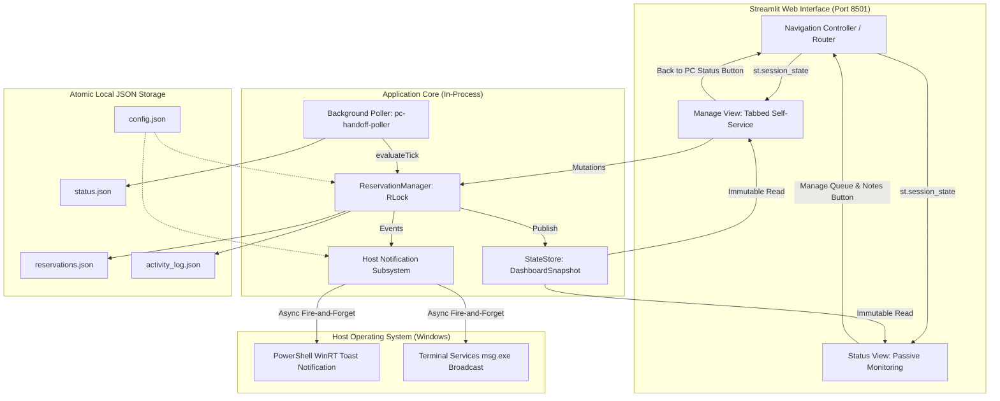

# System Design Document: Dedicated Management UI, Host Notifications & Advanced Self-Service (SD002)

- **Document Version**: `v0.2`
- **Requirement Target**: `REQ-003: Dedicated Management UI, Host Notifications & Advanced Self-Service`
- **Target Release**: `v0.3.0-manage-and-notify`
- **Status**: Draft / Pending Implementation
- **Supercedes / Extends**: `SD001_System_Design_v0.1.md` (REQ-002)

---

## 1. System Overview & Problem Statement

In `v0.2.0` (REQ-002), self-service reservation, ownership handoff, and broadcast notes were embedded directly at the bottom of the main PC status page behind a single checkbox toggle. While fully functional, operational feedback identified four key usability and workflow gaps:

1. **Dashboard Ergonomics**: The main dashboard is primarily a passive monitoring display used on wallboards and remote browser tabs. Intermixing interactive forms at the bottom of the page clutters the interface and risks accidental input.
2. **Tabbed Workflow Separation**: Joining a queue, handing off PC ownership, and posting status notes represent distinct user intentions. Presenting them as a single stacked form adds visual noise.
3. **Passive Waiting & Blind Queueing**: When a remote user joins the queue, the active user sitting at the physical PC (or in a full-screen RDP session) has no immediate indication that someone is waiting unless they keep the web dashboard visible.
4. **Friction in Handoff & Connection**: Once a handoff is offered, the incoming user must manually open `mstsc.exe` and type the PC hostname/IP, and users who make minor mistakes in duration or notes must cancel and lose their position in line.

`REQ-003` resolves these issues while preserving the project's core architecture principles:
- **Zero External Dependencies / 100% Offline-First**: No external cloud brokers, databases, or pip notification packages.
- **Strict Quality Gates**: Complete test coverage (`>= 86%`, maintaining target `100%`), 0 ruff errors, and complete audit logging.

---

## 2. Architecture & Component Decomposition



---

## 3. UI Navigation & Layout Design

### 3.1 Two-View Routing Model

To support modular maintenance and testability without multi-process server overhead, UI navigation is managed via a dedicated `NavigationController`:
- **State Storage**: `st.session_state["current_view"]` (`"status"` or `"manage"`, defaulting to `"status"`).
- **Navigation Buttons**:
  - **On Status View (Main)**: A prominent header action button in the top right:
    `st.button("⚙️ Manage Queue & Notes", key="nav_to_manage", use_container_width=True)`
  - **On Manage View**: A prominent header return button in the top left:
    `st.button("← Back to PC Status", key="nav_to_status")`

### 3.2 Tabbed Management Interface (`ManageView`)

The dedicated Manage page organizes actions into three semantic tabs:
1. **Tab 1: ➕ Join Queue**:
   - Live wait-time indicator: *"Estimated start time: ~14:30 (Wait: ~45 min)"* calculated from the active session's remaining duration + sum of queued durations.
   - Input fields: User Name (`1..64` chars), Requested Duration (`5..480` min), Notes (`0..280` chars).
   - "Join Queue" submission button.
   - List of non-terminal reservations with inline **"Edit"** and **"Cancel"** actions for the user's slot.
2. **Tab 2: 🤝 Ready to Handoff**:
   - Current active reservation summary and status.
   - "Current user offering handoff" input and **"Ready to Handoff"** trigger button.
   - When a reservation is `READY` (claim window open):
     - Countdown timer display.
     - **"Claim Now"** button.
     - **"Download .rdp Connection File"** button generating an in-memory `.rdp` file pre-populated with `full address:s:<hostname-or-ip>:3389`.
3. **Tab 3: 📝 Post Status Note**:
   - Author name (`1..64` chars) and Message (`1..280` chars).
   - Category selector: `General`, `Urgent / Do Not Interrupt`, `Maintenance`, `Long-Running Job`.
   - TTL duration selector (`5..1440` min).
   - "Post Status Note" submission button.
   - Table of active notes with inline **"Clear Note"** buttons.

---

## 4. Host PC Notification Subsystem

### 4.1 Trigger Events
Notifications are dispatched to the host PC on three key lifecycle milestones:
1. `RESERVATION_QUEUED`: When a user joins the queue (e.g. *"Bob joined the reservation queue (60 min)"*).
2. `HANDOFF_INITIATED`: When the PC is ready for the next user or handoff is offered (e.g. *"PC is ready for Bob — 5 min grace period to claim"*).
3. `RESERVATION_EXPIRED`: When a claim window lapses (e.g. *"Bob's claim window expired; handoff moved to Carol"*).

### 4.2 Zero-Dependency Windows Implementation
To comply with the offline-first, zero-external-pip-dependency guardrail, host notifications are executed using built-in Windows facilities via subprocess:

1. **Windows Toast Notification (Default: `"toast"`)**:
   - Uses PowerShell to invoke native WinRT `[Windows.UI.Notifications.ToastNotificationManager]` with an XML toast payload.
   - Displays as a standard non-intrusive Windows 10/11 Action Center banner.
2. **Terminal Services Broadcast (Alternative: `"msg"`)**:
   - Invokes `msg.exe * /time:<timeout> "<message>"` to broadcast an interactive modal dialogue to active console and RDP sessions on the host.
3. **Disabled (`"none"`)**:
   - Completely suppresses host notification subprocesses.

### 4.3 Resilience & Asynchronous Execution
- **Thread Isolation**: Notifications are dispatched asynchronously via a dedicated background worker / thread pool (`concurrent.futures.ThreadPoolExecutor(max_workers=1)`) with a non-blocking queue.
- **Failure Containment**: Any `subprocess.TimeoutExpired` or `OSError` is caught, logged at `WARNING`, and never propagates to the caller. A failure to show a notification never impedes the poller loop or UI responsiveness.

---

## 5. Domain Models & Schema Extensions

### 5.1 Note Categories
Extend `StatusNote` and `ReservationAuditEvent` with an optional `category`:
```python
class NoteCategory(StrEnum):
    GENERAL = "general"
    URGENT = "urgent"
    MAINTENANCE = "maintenance"
    LONG_RUNNING = "long_running"
```

### 5.2 Reservation Editing
Allow modifying `requestedDurationMinutes` and `notes` on `QUEUED` reservations:
- Pure transition: `updateReservation(state: QueueState, reservationId: str, duration: int, notes: str | None, now: datetime) -> TransitionOutcome`
- New audit event type: `reservation_updated` in `activity_log.json`.

### 5.3 Configuration Extensions (`config.json`)
```json
{
  "schemaVersion": 1,
  "dashboardRefreshIntervalSeconds": 10,
  "sessionPollIntervalSeconds": 5,
  "dashboardPort": 8501,
  "enableHostNotifications": true,
  "hostNotificationMethod": "toast",
  "hostNotificationTimeoutSeconds": 10
}
```

---

## 6. Security & Safe Rendering

1. **Sanitization**: All user inputs (names, messages, notes, categories) continue through `sanitize()` (removing Unicode `Cc` and `Cf` control characters).
2. **Markdown Neutralization**: Markdown strings rendered in headings, banners, and notes continue through `escapeMarkdown()`.
3. **RDP File Safety**: Generated `.rdp` files contain only static, safe parameters (`full address:s:<host>:3389`, `prompt for credentials:i:1`) and never execute shell commands or store passwords.
4. **No HTML**: No Streamlit component permits `unsafe_allow_html=True`.
