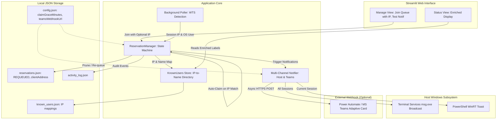

# System Design Document: Extended Queue Life, Smart Handoff Correlation & Multi-Channel Notifications (SD003)

- **Document Version**: `v0.3`
- **Requirement Target**: `REQ-004: Extended Queue Life, Smart Handoff Correlation & Multi-Channel Notifications`
- **Target Release**: `v0.3.4`
- **Status**: Draft / Pending Implementation
- **Supercedes / Extends**: `SD002_System_Design_v0.2.md` (REQ-003) & `SD001_System_Design_v0.1.md` (REQ-002)

---

## 1. System Overview & Problem Statement

In `v0.3.0`–`v0.3.3`, PC Handoff introduced FIFO queueing, ownership handoff, host desktop notifications, and a collapsible dashboard. Real-world operational usage on shared lab/office PCs identified four critical workflow gaps:

1. **Premature Queue Expiration & Loss of Queue Position**:
   - The claim grace window is hardcoded to 5 minutes (`CLAIM_GRACE_SECONDS = 300`).
   - Teams frequently need to queue in the evening for next-morning work or step away from their desk.
   - When the 5-minute timer expires, the reservation permanently transitions to `EXPIRED` and disappears from the queue, forcing users to restart their reservation.
2. **Silent Handoffs & Generic Account Blindspots**:
   - Shared PCs frequently use generic local Windows logins (e.g., `user`, `admin`, `tester`) rather than individual domain accounts.
   - When PC access is handed off informally, the incoming user connects directly via RDP without clicking "Claim" in the web dashboard.
   - The detection engine observes an active session from the user's IP, but because the OS username doesn't match or the reservation wasn't manually claimed, the system marks the reservation `EXPIRED` while the user is actively working.
3. **Host Notification Delivery Failures**:
   - Default host notification method is `"toast"`. Windows WinRT toasts only display in the session of the process owner and are suppressed across RDP session boundaries.
   - The active user working inside an RDP session never sees the toast when another team member joins the queue.
4. **Lack of Mobile/Chat Visibility (MS Teams)**:
   - Users not currently staring at the shared PC host screen have no way of knowing when they are next in line or when the PC becomes available.

`REQ-004` resolves these issues while upholding the project's governance guardrails:
- **Offline-First & Graceful Degradation**: Zero external dependencies added to pip; Teams notifications use standard library `urllib.request` and fail gracefully when offline.
- **Strict Quality Gates**: Complete unit/integration/acceptance coverage (`>= 86.0%`, target `100.0%`), 0 ruff errors, and audit logging.

---

## 2. Architecture & Data Flow



---

## 3. Core Capability Specifications

### 3.1. Configurable Claim Grace Period & Re-queue State Machine

#### A. Configuration
In `config.json` and `RuntimeConfig`:
- `claimGraceMinutes: int = 60` (Range: `1` to `1440` minutes / 24 hours).
- Allows users to queue in the evening for morning access.

#### B. `REQUEUED` State Transition
- Extend `ReservationStatus` enum with `REQUEUED = "REQUEUED"`.
- Extend `ReservationEventType` with `RESERVATION_REQUEUED = "reservation_requeued"`.
- Transition rule:
  - When a `READY` reservation reaches its `claimExpiresAt` deadline:
    1. If `len(queue) == 1`: The single reservation updates status to `REQUEUED`, refreshes its `readyAt` and `claimExpiresAt`, remaining in the queue so the reservation is never lost.
    2. If `len(queue) > 1`: The reservation updates status to `REQUEUED`, clears `claimExpiresAt`, and is appended to the **tail** (end) of `activeReservations`.
    3. The next queued reservation at index 0 advances to `READY` with a fresh `claimExpiresAt` timer.
  - Display badge in UI: `🔄 Re-queued`.

---

### 3.2. Client IP Collection, Real Name Mapping & Silent Handoff Detection

#### A. Registration with Optional Client IP
- In Manage View (Join Queue form):
  - Field: **Your Name** (e.g., `John Doe`)
  - Field: **Client IP Address (Optional)**: Automatically pre-fills or prompts for client IP (e.g. `192.168.1.55`).
  - Field: **Estimated duration** & **Notes**.

#### B. Persistent `known_users.json` Directory
- Store user associations in `data/known_users.json`:
  ```json
  {
    "192.168.1.55": {
      "displayName": "John Doe",
      "lastSeenAt": "2026-10-29T12:00:00+09:00"
    }
  }
  ```
- Any reservation submitted with an IP updates this directory atomically.

#### C. Silent Handoff Auto-Claim
- During poller evaluation:
  - When an active RDP session is detected from `session.clientAddress`:
    - If the `READY` reservation has matching `clientAddress == session.clientAddress`:
      - The reservation is **automatically claimed** (`claimHandoff`), transitioning to `CLAIMED` without requiring manual web dashboard button clicks.
      - Emits `handoff_claimed` audit event with `trigger: "auto_ip_correlation"`.

#### D. Enriched Dashboard Status Display
- When formatting `badgeText` and session tables:
  - If `session.clientAddress` is mapped in `known_users.json`:
    - If display name matches OS account: `🔴 In Use — John Doe (192.168.1.55)`
    - If display name differs from generic OS account: `🔴 In Use — John Doe [lab_user] (192.168.1.55)`

---

### 3.3. Reliable Host PC Notifications

1. **Broadcast to Active RDP Sessions**:
   - Support `hostNotificationMethod`: `"msg"`, `"toast"`, `"both"`, `"none"`.
   - Default: `"both"` (or `"msg"`).
   - `msg.exe * /time:<timeout>` broadcasts directly across all active Windows Terminal Services sessions so active RDP users immediately receive the popup.
2. **WinRT Toast Fix**:
   - Ensure Start Menu shortcut registration on startup so Windows Action Center does not discard desktop toasts.
3. **Interactive Test Button**:
   - Add **"🔔 Test Host Notification"** button in Manage View to verify end-to-end delivery on the shared PC.

---

### 3.4. Microsoft Teams / Power Automate Webhook Integration

#### A. Configuration
In `config.json`:
```json
{
  "enableTeamsNotifications": false,
  "teamsWebhookUrl": ""
}
```
Validation: Must be a valid HTTPS URL (or empty string when disabled).

#### B. Triggered Events
Dispatches Teams notification on:
1. `RESERVATION_QUEUED`: When someone joins the queue (`"👤 <Name> joined the queue (<Duration> min)"`).
2. `HANDOFF_INITIATED` / `READY`: When the PC is available for the next person (`"🔔 PC is ready for <Name> — <Grace> min to claim"`).

#### C. Adaptive Card Payload
Standard Teams Power Automate webhook JSON:
```json
{
  "type": "message",
  "attachments": [
    {
      "contentType": "application/vnd.microsoft.card.adaptive",
      "content": {
        "$schema": "http://adaptivecards.io/schemas/adaptive-card.json",
        "version": "1.4",
        "type": "AdaptiveCard",
        "msteams": {"width": "Full"},
        "body": [
          {
            "type": "TextBlock",
            "text": "PC Handoff: Queue Joined",
            "weight": "Bolder",
            "size": "Medium",
            "color": "Accent"
          },
          {
            "type": "TextBlock",
            "text": "John Doe joined the reservation queue (60 min).",
            "wrap": true
          }
        ],
        "actions": [
          {
            "type": "Action.OpenUrl",
            "title": "Open PC Handoff",
            "url": "http://192.168.1.20:8502"
          }
        ]
      }
    }
  ]
}
```

#### D. Non-Blocking Delivery & Failure Containment
- Async execution in dedicated worker thread via Python `urllib.request`.
- Timeout: 5 seconds.
- OS/Network errors caught, logged as warnings in `app.log`, and never block the local poller or dashboard.
